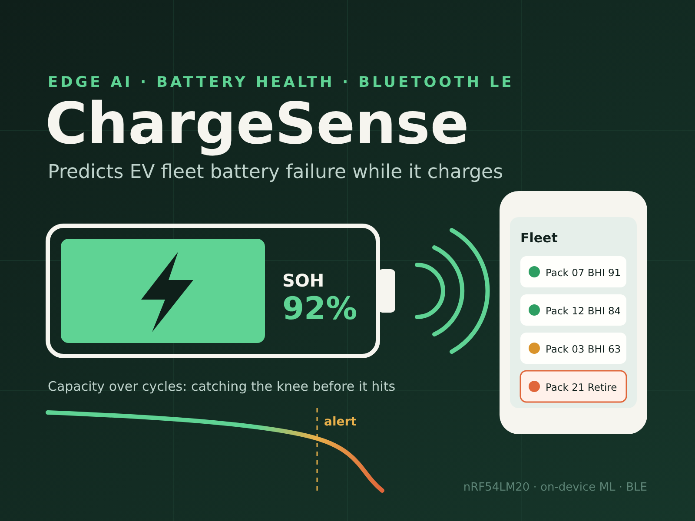
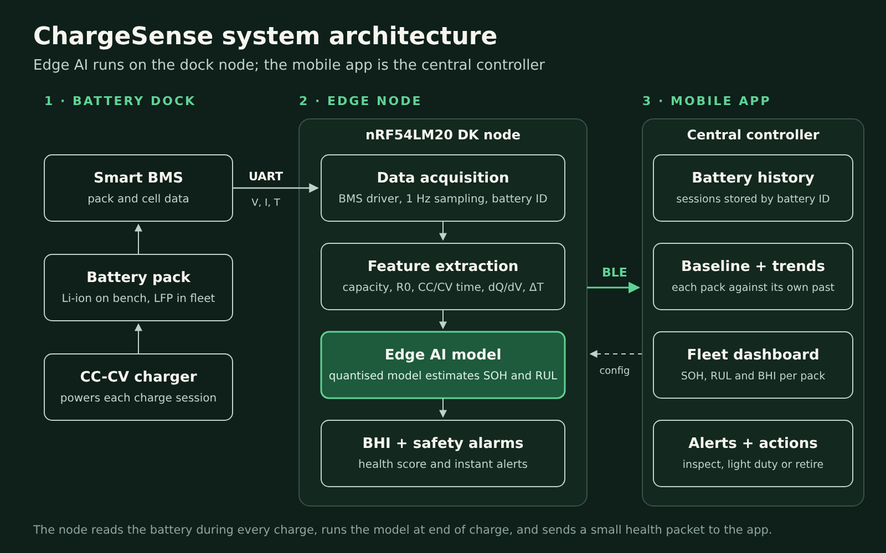

# ChargeSense

**Edge AI that predicts EV fleet battery health while it charges, and warns over Bluetooth before a battery fails.**



> **Status: work in progress.** This repository is being built for the Nordic Semiconductor *Sustain the System* contest on Hackster and as part of my final-year research. Sections are filled in as each stage is completed.

## The problem

Electric motorbike, tricycle and battery-swap fleets charge their lithium batteries every day, and the batteries rotate between riders and stations. Operators rarely know how each battery has aged. LFP cells fade slowly, then drop sharply at a "knee", so a battery can look healthy shortly before it fails.

Standard BMS boards report voltage, current and charge level, but not a reliable state of health or remaining life. Classical estimators (Coulomb counting, equivalent circuit models, Kalman filters) assume a new cell's parameters and drift as the battery ages.

## The solution

ChargeSense turns every charge session into a health check. A node at each charging dock reads the battery's BMS during charging, extracts ageing features, and runs a small machine-learning model on the **Nordic nRF54LM20**. Results go over **Bluetooth LE** to a **mobile app**, which acts as the central controller for the fleet.

For each battery it reports:

- **State of health (SOH)**: remaining capacity compared with new
- **Remaining useful life (RUL)**: cycles left until 80% SOH
- **Battery Health Index (BHI)**: one 0–100 score with an action (healthy, watch, degraded, retire)
- **Safety alerts**: over-temperature, fast temperature rise, abnormal voltage, cell imbalance

## Architecture



| Layer | Hardware / software | Role |
|---|---|---|
| Battery dock | Smart BMS, battery pack, CC-CV charger | Provides pack and cell data during charge |
| Edge node | nRF54LM20 DK | Data acquisition, feature extraction, on-device model, BHI and alarms |
| Central controller | Mobile app | Battery history by ID, trends, fleet dashboard, alerts |

## Features used by the model

| Feature | What it reveals |
|---|---|
| Charged capacity | Capacity fade from lost lithium |
| Internal resistance (ΔV / ΔI at a current step) | SEI growth, contact loss |
| Constant-current and constant-voltage charge times | Rising resistance |
| Charge-curve shape (dQ/dV) vs. the battery's own baseline | Early ageing, knee warning |
| Temperature rise during charge | Heating, fault risk |
| Cell voltage spread at full charge | Imbalance, weak cell |

## Repository layout

```
chargesense/
├── docs/       Architecture, chemistry notes, images
├── data/       Dataset instructions (raw data is not committed)
├── model/      Dataset processing, feature extraction, training, quantisation
├── firmware/   nRF54LM20 firmware (nRF Connect SDK)
└── app/        Mobile app (central controller)
```

## Dataset

Models are trained on the MIT/Stanford battery cycle-life dataset: 124 commercial LFP/graphite cells cycled under fast-charging conditions, with cycle lives from 150 to 2,300 cycles.

- Severson, K. A. et al. *Data-driven prediction of battery cycle life before capacity degradation.* Nature Energy 4, 383–391 (2019). https://doi.org/10.1038/s41560-019-0356-8
- Data: https://data.matr.io/1

See [`data/README.md`](data/README.md) for download steps.

## Validation plan

1. **Model accuracy**: SOH and RUL error on held-out cells, compared with Random Forest, XGBoost and a physics-based fade model, before and after quantisation.
2. **Hardware-in-the-loop**: recorded charge sessions streamed into the nRF54LM20 DK in real time, measuring inference time, RAM/flash use, current draw and BLE packet delivery.
3. **Live bench test**: a real battery pack and smart BMS, testing acquisition, end-of-charge detection, alerts and the BLE link end to end.

## Roadmap

- [x] Battery chemistry and ageing study (LFP, LCO)
- [x] Review of classical SOC/SOH estimation methods
- [x] System architecture and feature set
- [ ] Dataset processing and feature extraction
- [ ] Model training and comparison
- [ ] Quantisation and deployment to the nRF54LM20
- [ ] BMS driver and BLE health service on the node
- [ ] Mobile app: battery history, dashboard, alerts
- [ ] Hardware-in-the-loop and bench validation
- [ ] Results and demo video

## Author

[Your name], Electrical and Electronics Engineering, Federal University of Technology, Akure (FUTA), Nigeria.

## License

Released under the MIT License. See [LICENSE](LICENSE).
